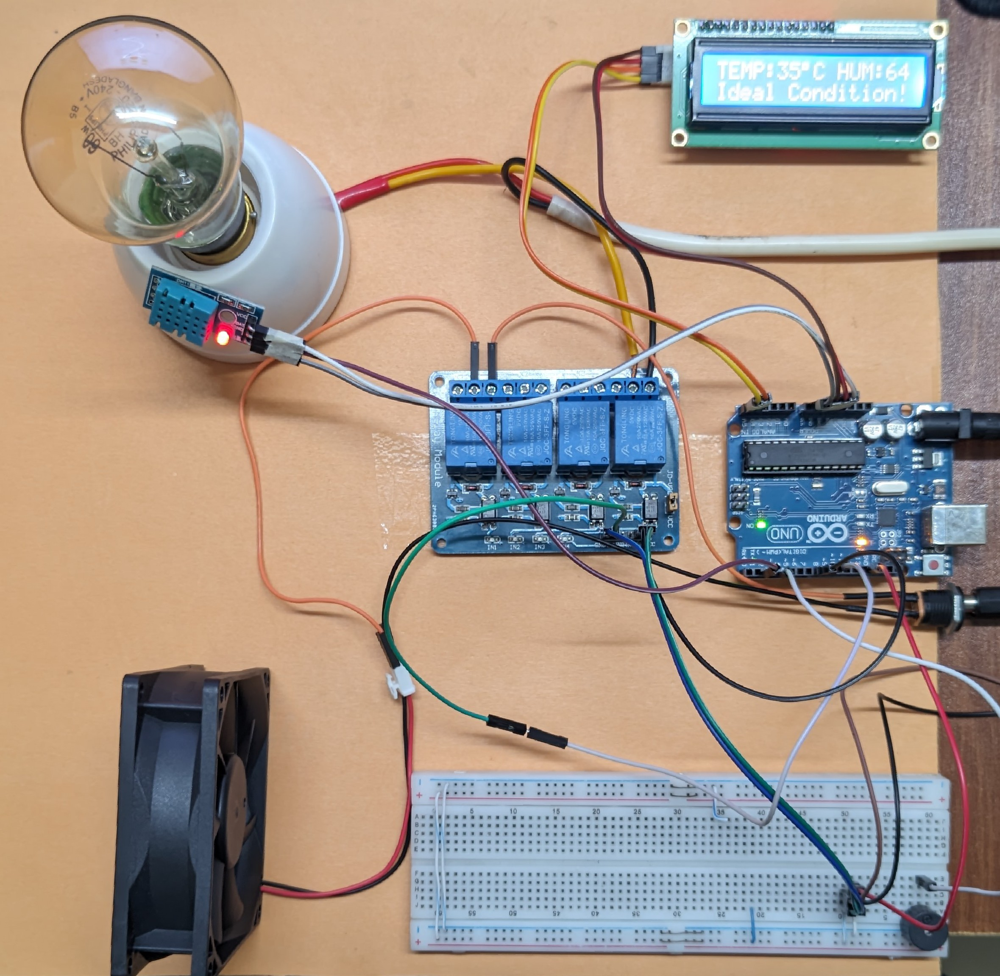
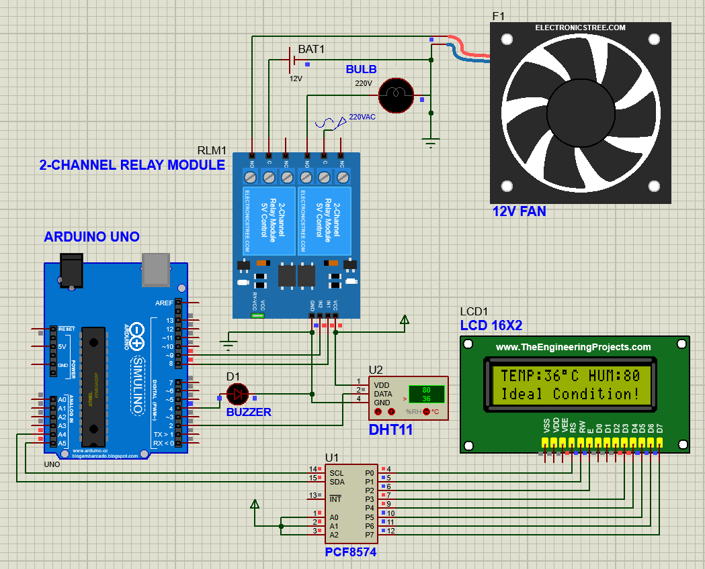

# Smart Incubation System

An Arduino Uno prototype that monitors temperature and humidity with a DHT11, switches a heating bulb and cooling fan through active-LOW relays, and displays readings on a 16x2 I2C LCD. A buzzer indicates heater and fan activation.

Built by **Imran Yakub** and **Md. Sayem Ur Rahman** for **EEE 3506 - Microprocessor & Interfacing Sessional**, International Islamic University Chittagong. The supplied report is dated **16 June 2025**.

## What is included

- [Arduino sketch](firmware/SmartIncubation/SmartIncubation.ino), reconstructed from the report's code table.
- [Original report PDF](docs/source/Project_Report.pdf).
- Circuit diagram, flowcharts, Proteus screenshots, and hardware photos.
- [Compressed demonstration video](media/demo-web.mp4) (download to play).
- [Hardware and setup guide](docs/hardware.md), [control logic](docs/operation.md), and [source provenance](docs/provenance.md).

**No original `.ino`, compiled firmware, or editable Proteus project was present in the ZIP.** The sketch here is a documented reconstruction, not a recovered original. Humidity is monitored only; no humidifier or humidity-control loop is implemented.

## Control behavior

| Output | Turn ON | Turn OFF |
| --- | --- | --- |
| Heating bulb | Temperature <= 34.5 C | Temperature >= 35 C |
| Cooling fan | Temperature > 38.5 C | Temperature <= 37 C |

Each output retains its previous state between its thresholds (hysteresis). Settings reproduce the report and are not validated incubation recommendations. The DFRobot library supplies whole-degree temperature values, so fractional thresholds do not imply fractional measurement resolution.

## Pin assignments

| Component | Arduino Uno pin / setting |
| --- | --- |
| DHT11 data | D2 |
| Buzzer | D4 |
| Heating relay input | D8, active LOW |
| Fan relay input | D9, active LOW |
| 16x2 I2C LCD SDA | A4 |
| 16x2 I2C LCD SCL | A5 |
| LCD I2C address | `0x27` |

See the [hardware and wiring guide](docs/hardware.md) for additional setup details.

## Open and upload

1. Clone or download this repository.
2. Open `firmware/SmartIncubation/SmartIncubation.ino` in Arduino IDE, keeping `control.h` in the same folder.
3. Install **DFRobot_DHT11** and a **LiquidCrystal_I2C** implementation supporting `init()` and `backlight()`. `Wire` is included with the Arduino AVR core. Exact historical library versions were not supplied.
4. Select **Arduino Uno** and the correct serial port.
5. Check [pin assignments and relay polarity](#pin-assignments). Verify the LCD address (`0x27` in the report).
6. Compile and upload. First test relay behavior with the heater disconnected.

The supplied circuit shows a 220 V bulb. Mains wiring requires appropriate isolation, enclosure, protection, and qualified handling; use low-voltage test loads for initial verification.

## Gallery

| State | Hardware | Proteus screenshot |
| --- | --- | --- |
| Idle | [Photo](docs/images/hardware-idle.jpg) | [Screenshot](docs/images/proteus-idle.png) |
| Heating | [Photo](docs/images/hardware-light-on.jpg) | [Screenshot](docs/images/proteus-light-on.png) |
| Cooling | [Photo](docs/images/hardware-fan-on.jpg) | [Screenshot](docs/images/proteus-fan-on.png) |

## Validation and limitations

The reconstructed control logic passed native C++ tests covering thresholds, hysteresis, and transitions. Arduino compilation, Proteus simulation, physical outputs, and sensor disconnection behavior have not been verified here. Original photos and video document the supplied project; they do not validate this reconstructed firmware.

The sensor library does not expose a reliable success result or validate the checksum in its inspected implementation. Range checks cannot detect all faults or stale/plausible readings. This is an educational prototype, not a fail-safe environmental controller. Independent thermal protection and reliable sensor fault detection are needed before unattended heating.

No measured hatch rate, calibrated accuracy, power consumption, cost, or new experimental results are claimed. No repository-wide license has been selected; included academic materials retain their authorship.
