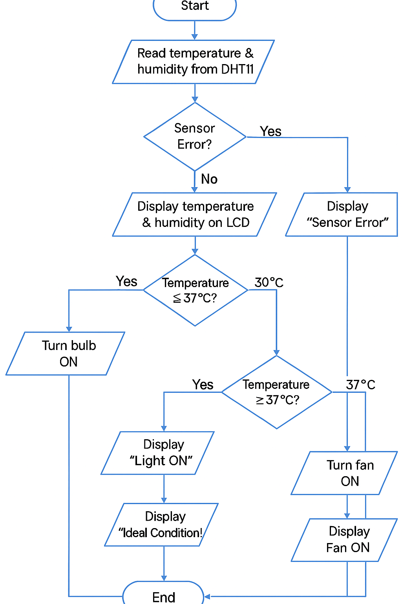

# Operation

The sensor is read once per loop. The sketch updates separate heater and fan states, drives active-LOW relays, displays temperature/humidity and the active state, then waits two seconds. Buzzer sequences add blocking time: two beeps when heating starts, three when cooling starts.

The heater turns on at or below 34.5 C and turns off at or above 35 C. The fan turns on strictly above 38.5 C and turns off at or below 37 C. In the intervening bands, each output holds its state. Both start OFF. Humidity is displayed without an actuator.



[Additional supplied flowchart](images/flowchart.png)

## Reconstruction changes

The report's code table omits several closing braces. The new sketch restores complete setup/loop structure, keeps heater and fan decisions independent, and extracts their state transitions into `control.h`. Display status uses the retained output states so it remains correct within hysteresis bands. The readings line is shortened to fit 16 characters. The startup contributor-ID screen is omitted; authorship is in the README and original report. The buzzer uses its named pin constant.

The report's `temperature == 255 || humidity == -1` check is not a reliable sensor-failure contract. The inspected DFRobot implementation has a void read method, whole-byte fields, no reported checksum validation and no explicit read-success flag. The new sketch uses a simple 0-50 C / 0-100% plausibility check, but a disconnected sensor can still produce plausible values. Do not interpret it as comprehensive fault handling.

Reference implementation inspected during preparation: [DFRobot_DHT11.cpp](https://github.com/DFRobot/DFRobot_DHT11/blob/master/DFRobot_DHT11.cpp). Dependency versions are not pinned; inspect the version you install.

## Native control test

From the repository root:

```sh
g++ -std=c++11 -Wall -Wextra -pedantic tests/control_test.cpp -o /tmp/incubation-control-test
/tmp/incubation-control-test
```

This tests only the pure state-transition function. It does not simulate the sensor library, timing, LCD, relay polarity, wiring, or Arduino build.
